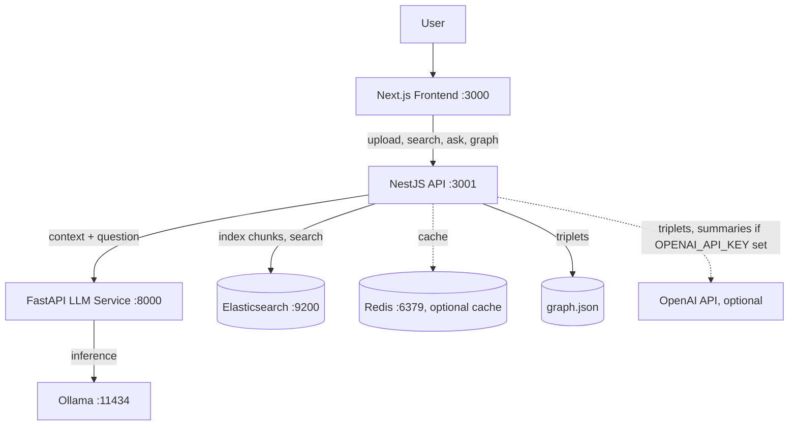

# InsightGraph Platform

[](https://github.com/Sodabeh-Taherpanah/insightgraph-platform/actions/workflows/ci.yml)

AI-powered document search with RAG and streaming, built with clear service boundaries.

Users upload documents, ask natural-language questions, and get answers generated by a local LLM from the best-matching chunks, with source attribution and relevance scores. A simple knowledge graph is extracted at upload time and shown in the UI.

- Token streaming over Server-Sent Events (`/ask/stream`) and a non-streaming endpoint (`/ask`)
- Document chunking (512-token target, 100-token overlap; tokens are approximated as 1.3 per word)
- Keyword retrieval with Elasticsearch full-text search (no vector embeddings yet)
- Optional Redis cache for search and context lookups
- Three services: NestJS (ingest, retrieval, orchestration), FastAPI (LLM calls), Next.js (UI)

> This is a portfolio / learning project. It has no authentication, only a small automated test suite, and is not production-hardened. See [Known limitations](#known-limitations).

## Screenshots

_Screenshots coming soon._

<!-- Add images to docs/screenshots/ and reference them here, e.g.  -->

## Tech stack

| Layer | Technology |
| --- | --- |
| Frontend | Next.js 16, React 19, Tailwind CSS, React Flow (graph view) |
| Backend | NestJS 10 (Express adapter), TypeScript, Zod, Winston |
| LLM service | FastAPI, httpx |
| Model runtime | Ollama (default model `llama3.1`) |
| Search | Elasticsearch 8.x (full-text `multi_match`) |
| Cache (optional) | Redis via `ioredis`, fails open when unavailable |
| Graph storage | JSON file at `backend/data/graph.json` |

## Architecture



### System flow

1. **Upload**: the user posts text or a file (`.txt`, `.md`, `.docx`, `.xlsx`, `.pdf`).
2. **Ingest**: the backend normalizes the text, splits it into overlapping chunks, and indexes each chunk in Elasticsearch. It also extracts subject-predicate-object triplets (OpenAI if `OPENAI_API_KEY` is set, otherwise a simple heuristic) and stores them in the graph file. No embeddings are computed.
3. **Retrieve**: for a question, the backend runs a keyword `multi_match` query and builds a context from the top highlighted fragments.
4. **Generate**: the backend sends context and question to the FastAPI service, which calls Ollama.
5. **Stream**: tokens are relayed to the browser as SSE, followed by the list of sources.

## API endpoints (NestJS, port 3001)

| Method | Path | Purpose |
| --- | --- | --- |
| POST | `/upload` | Ingest text (`title`, `text` or `content`) or a multipart `file` |
| POST | `/ask` | Answer a question, returns JSON `{ answer, sources }` |
| POST | `/ask/stream` | Same, streamed as Server-Sent Events |
| GET | `/search?q=` | Full-text search over chunks |
| GET | `/documents/:id` | Fetch an indexed chunk by id |
| POST | `/documents/:id/summary` | Summary of a chunk's text |
| GET | `/documents/:id/summary/stream` | Streamed summary (SSE) |
| GET | `/graph` | Nodes and edges extracted at upload time |

Requests are rate-limited to 60 per minute per IP.

The summary endpoints use OpenAI when `OPENAI_API_KEY` is set. Otherwise they return a heuristic extract (first sentences), not an LLM-written summary. They operate on a single indexed chunk id, not on a whole uploaded document.

### Upload

```bash
curl -X POST http://localhost:3001/upload \
  -H "Content-Type: application/json" \
  -d '{"title": "Docker Guide", "content": "Docker is a platform for running applications in containers."}'
```

Response:

```json
{
  "indexed": "Docker Guide",
  "chunksCreated": 1,
  "triplets": [],
  "graph": { "nodes": [], "edges": [] }
}
```

### Ask

```bash
curl -X POST http://localhost:3001/ask \
  -H "Content-Type: application/json" \
  -d '{"question": "What is Docker?"}'
```

```json
{
  "answer": "Docker is a platform for...",
  "sources": [{ "id": "Docker Guide#chunk_0", "title": "Docker Guide (Part 1/1)", "score": 9.12 }]
}
```

### Ask (streaming)

```bash
curl -N -X POST http://localhost:3001/ask/stream \
  -H "Content-Type: application/json" \
  -d '{"question": "What is Docker?"}'
```

Each event is a `data:` line followed by a blank line:

```
data: {"type":"answer","content":"Docker"}

data: {"type":"answer","content":" is"}

data: {"type":"sources","sources":[...]}

data: [DONE]
```

On failure an event of the form `{"type":"error","error":"..."}` is sent.

## Quick start with Docker

Requires Docker with Compose v2 and roughly 8 GB of free RAM for the model.

```bash
docker compose up --build -d
docker compose exec ollama ollama pull llama3.1   # one-time model download (several GB)
```

Open http://localhost:3000. Services start in dependency order using healthchecks (Elasticsearch, Redis, Ollama, then llm-service, backend, frontend). Check status with `docker compose ps`.

| Service | Port |
| --- | --- |
| Frontend | 3000 |
| Backend (NestJS) | 3001 |
| LLM service (FastAPI) | 8000 |
| Ollama | 11434 |
| Elasticsearch | 9200 |
| Redis | 6379 |

Elasticsearch runs with security disabled, which is only suitable for local development. Graph data is kept in the `backend_data` volume; models in `ollama_data`.

## Quick start (manual)

Prerequisites: Node.js 22+, Python 3.11+, Elasticsearch 8.x on port 9200, Ollama with `llama3.1`. Redis is optional.

```bash
# 1. Elasticsearch (single node, security off, for local development only)
docker run -d -p 9200:9200 -e "discovery.type=single-node" -e "xpack.security.enabled=false" \
  docker.elastic.co/elasticsearch/elasticsearch:8.11.0

# 2. Ollama
ollama serve &
ollama pull llama3.1

# 3. LLM service
cd llm-service
python -m venv venv && source venv/bin/activate
pip install -r requirements.txt
cp .env.example .env
uvicorn main:app --reload --port 8000

# 4. Backend (new terminal)
cd backend
cp .env.example .env     # the backend reads real environment variables; export them or use your shell's env loader
npm install
npm run dev              # http://localhost:3001

# 5. Frontend (new terminal)
cd frontend
npm install
npm run dev              # http://localhost:3000
```

Optional Redis: `docker run -d -p 6379:6379 redis:7-alpine`. Without it the backend logs a warning and skips caching.

Each service has a `.env.example` listing every variable the code reads.

## Design decisions

**Polyglot services.** NestJS handles I/O orchestration and validation. Python/FastAPI isolates LLM calls, so the provider can be swapped without touching the API. The cost is two runtimes to operate.

**Chunking.** Whole documents are too large for the model context and dilute ranking. Chunks carry `sourceId`, `sourceTitle`, `chunkIndex`, `totalChunks`, `startPosition` and `endPosition`. Implementation: `backend/src/utils/chunking.ts`.

**Full-text retrieval first.** Elasticsearch `multi_match` over `title^2` and `text` keeps retrieval simple and debuggable. It misses semantic matches that share no keywords with the question.

## Project structure

```
fullstack_insightgraph_AI/
├── backend/                  # NestJS API
│   ├── src/
│   │   ├── main.ts           # bootstrap
│   │   ├── app.module.ts     # root module, rate limiting
│   │   ├── controllers/      # ask, upload, search, documents, graph
│   │   ├── services/         # askService, ingestService, searchService,
│   │   │                     # aiService, graphService, redisService
│   │   ├── common/filters/   # exception filter
│   │   └── utils/            # chunking, fileParser, errors, logger
│   ├── Dockerfile
│   ├── *.spec.ts (next to the code it tests)
│   └── .env.example
├── llm-service/              # FastAPI: /health, /llm/ask, /llm/stream
│   ├── main.py
│   ├── Dockerfile
│   ├── requirements.txt
│   ├── test-llm-service.sh
│   └── .env.example
├── frontend/                 # Next.js app router
│   ├── app/                  # pages: ask, upload, search, graph, documents/[id]
│   ├── components/
│   ├── lib/
│   ├── Dockerfile
│   └── .env.example
├── docker-compose.yml        # full stack with healthchecks
├── .github/workflows/ci.yml  # CI
├── start.sh                  # starts llm-service, backend and frontend locally
└── README.md
```

## Tests and CI

```bash
cd backend
npm run lint
npm test            # Jest: chunking unit tests, POST /ask and /ask/stream (SSE) integration tests
npm run typecheck
```

The `/ask` tests mock the Elasticsearch/Redis layer and the FastAPI call, so they need no running services. GitHub Actions (`.github/workflows/ci.yml`) runs lint, type-check, build and tests for the backend, lint and build for the frontend, and `ruff` for the llm-service. Frontend lint currently reports pre-existing errors and is non-blocking in CI.

## Testing the LLM service directly

```bash
curl http://localhost:8000/health

curl -X POST http://localhost:8000/llm/ask \
  -H "Content-Type: application/json" \
  -d '{"question": "What is FastAPI?", "context": "FastAPI is a modern web framework for building APIs with Python."}'
```

`llm-service/test-llm-service.sh` runs a scripted version of these checks.

## Known limitations

- No authentication or authorization; all documents are visible to everyone.
- Test coverage is small: chunking and the `/ask` endpoints only. Upload, search, graph and the frontend are untested. The chunk overlap is about twice the intended 100 tokens (tracked as a `todo` test).
- Frontend lint reports existing errors; CI treats that step as non-blocking.
- Retrieval is keyword-based. There are no embeddings, no hybrid search and no reranking.
- No evaluation of answer quality or retrieval, and no guardrails against prompt injection from document content.
- The knowledge graph is a JSON file with heuristic (or OpenAI) triplet extraction. It is not a graph database, and entity resolution is naive.
- Summaries operate on a single chunk and fall back to a non-LLM heuristic without an OpenAI key.
- The Docker setup has been validated with `docker compose config` only; a full run on a machine with a Docker daemon is still to be confirmed.
- Uploaded text is limited by request size (5 MB JSON body) and there is no per-user storage or file persistence beyond the Elasticsearch index.

## Roadmap

- Fix chunk overlap, broaden test coverage (upload, search, frontend)
- Vector embeddings and hybrid (BM25 + vector) search
- Retrieval and answer evaluation (golden question set, citation accuracy)
- Guardrails: prompt-injection handling, answer-grounding checks
- Observability: structured request tracing and metrics
- Authentication and per-user document access
- Optional: Postgres for document metadata and object storage for original files

## License

MIT
