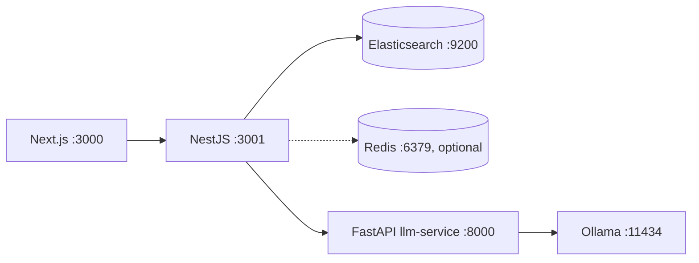

# InsightGraph

[](https://github.com/Sodabeh-Taherpanah/insightgraph-platform/actions/workflows/ci.yml)

Upload a text document, ask questions in plain language, and get streamed answers with the source passages they came from.


## Features

- **Upload**: paste text or upload a `.txt`, `.md`, `.docx`, `.xlsx` or `.pdf` file. The text is split into overlapping chunks and indexed.
- **Search**: keyword search over the chunks. Each result shows the chunk text and its BM25 score. No AI is involved.
- **Ask**: type a question. The answer is generated by a local LLM and streamed token by token, followed by the sources.

### Experimental / not linked

- A knowledge graph page (`/graph`) and the `GET /graph` endpoint. Subject-predicate-object triplets are extracted at upload time and stored in `backend/data/graph.json`. The page is not linked in the UI.

## Architecture



Flow of a question:

1. The frontend posts the question to `POST /ask/stream`.
2. The backend runs a BM25 `multi_match` query in Elasticsearch and takes the top chunks as context.
3. The backend sends the context and question to the llm-service, which calls Ollama.
4. Tokens are relayed to the browser as Server-Sent Events, followed by the sources.

The model receives the first three chunks of the ranking (`CONTEXT_CHUNKS`). The sources list is the top five search hits, so it can include chunks that were not sent to the model.

Redis is optional. It caches search and context lookups for 60 seconds.

### When a service is down

| Service down | What happens |
| --- | --- |
| Redis | No caching. Everything else works. |
| Elasticsearch | Chunks are stored in and searched from `backend/data/documents.json` with simple keyword counting (not BM25). Elasticsearch is tried again after 30 seconds. Nothing copies these chunks into Elasticsearch later. |
| llm-service or Ollama | The backend builds an answer from the context: sentences that contain words from the question. It is not an LLM answer. |

The UI does not show when it is in one of these fallback modes.

## Tech stack

| Layer | Technology |
| --- | --- |
| Frontend | Next.js 16, React 19, Tailwind CSS 4, React Flow (graph page) |
| Backend | NestJS 10, TypeScript, Zod, Winston |
| LLM service | FastAPI, httpx |
| Model runtime | Ollama, running natively |
| Search | Elasticsearch 8.11, BM25 `multi_match` on `title^2` and `text` |
| Cache | Redis 7 via `ioredis` (optional) |
| Local storage | JSON files in `backend/data/` |
| Tests and CI | Jest, ESLint, ruff, GitHub Actions |

There are no vector embeddings and no Postgres.

## Getting started

### Prerequisites

- Node.js 22 or newer
- Python 3.11 or newer
- Docker (used only for Elasticsearch and Redis)
- [Ollama](https://ollama.com), installed and running natively

### Steps

```bash
# 1. Pull a model. The code default is llama3.1; the measurements below used llama3.2:3b,
#    which is faster on a CPU.
ollama pull llama3.2:3b

# 2. Start Elasticsearch and Redis. Do not start the ollama service from the compose file.
docker compose up -d elasticsearch redis

# 3. Install dependencies
(cd llm-service && python3 -m venv venv && venv/bin/pip install -r requirements.txt)
(cd backend && npm install)
(cd frontend && npm install)

# 4. Configure the model
cp llm-service/.env.example llm-service/.env
#    then set OLLAMA_MODEL=llama3.2:3b in llm-service/.env

# 5. Start the llm-service, backend and frontend
./start.sh
```

Open http://localhost:3000. Next.js can take several seconds to compile on the first request. Press Ctrl+C to stop all three services.

`start.sh` runs the services in one terminal. The backend and frontend need no `.env` file; their defaults match the local setup.

### Environment variables

The backend reads real environment variables only. It does not load `.env` files. To change a backend variable, set it when you start the script, for example `CONTEXT_ORDER=index ./start.sh`.

| Variable | Service | Default | Purpose |
| --- | --- | --- | --- |
| `PORT` | backend | `3001` | Backend port |
| `ES_NODE` | backend | `http://localhost:9200` | Elasticsearch URL |
| `ES_INDEX` | backend | `insightgraph` | Index name |
| `LLM_SERVICE_URL` | backend | `http://127.0.0.1:8000` | llm-service URL |
| `REDIS_URL` | backend | `redis://localhost:6379` | Optional cache |
| `OPENAI_API_KEY` | backend | empty | Optional. Used for triplet extraction and summaries. Without it a simple heuristic is used. |
| `CONTEXT_CHUNKS` | backend | `3` | Number of chunks sent to the model as context. Experiment switch. |
| `CONTEXT_ORDER` | backend | `score` | `score` keeps Elasticsearch order. `index` orders the chunks by their position in the document. Experiment switch. |
| `OLLAMA_BASE_URL` | llm-service | `http://localhost:11434` | Ollama URL |
| `OLLAMA_MODEL` | llm-service | `llama3.1` | Model name |
| `PORT` | llm-service | `8000` | llm-service port |
| `NEXT_PUBLIC_API_URL` | frontend | `http://localhost:3001` | Backend URL, set at build time |

## API

NestJS backend on port 3001. Requests are limited to 60 per minute per IP.

| Method | Path | Purpose |
| --- | --- | --- |
| POST | `/upload` | Ingest text (`title`, `text` or `content`, up to 10,000 characters) or a multipart `file` |
| POST | `/ask` | Answer a question. Returns `{ answer, sources }`. |
| POST | `/ask/stream` | Same answer, streamed as Server-Sent Events |
| GET | `/search?q=` | Keyword search over chunks |
| GET | `/documents/:id` | One indexed chunk |
| POST | `/documents/:id/summary` | Summary of one chunk |
| GET | `/documents/:id/summary/stream` | Streamed summary |
| GET | `/graph` | Nodes and edges extracted at upload time |

Summaries use OpenAI when `OPENAI_API_KEY` is set. Otherwise they are the first sentences of the chunk.

Example:

```bash
curl -X POST http://localhost:3001/upload \
  -H "Content-Type: application/json" \
  -d '{"title": "Docker Guide", "content": "Docker is a platform for running applications in containers."}'

curl -N -X POST http://localhost:3001/ask/stream \
  -H "Content-Type: application/json" \
  -d '{"question": "What is Docker?"}'
```

Each streamed event is a `data:` line followed by a blank line:

```
data: {"type":"answer","content":"Docker"}

data: {"type":"answer","content":" is"}

data: {"type":"sources","sources":[...]}

data: [DONE]
```

Tokens carry their own whitespace, so clients must not trim them. On failure the stream sends `{"type":"error","error":"..."}`. The stream also contains `meta` and `stats` events used for latency measurement (see below). Clients can ignore them.

## Latency measurements

On a CPU, time to first token (TTFT) depends mostly on whether Ollama has already read the same prompt prefix. The prompt is the system prompt, then the retrieved context, then the question. So the context is the shared prefix. In a direct test, a prompt of about 2,000 tokens took 35.7 s to read the first time and 0.12 s when it was repeated.

With the chunks in Elasticsearch score order, the same chunks reached the model in many different orders, and every new order was a cold prompt. Ordering the chunks by their position in the document (`CONTEXT_ORDER=index`) gives the same chunk set the same context string. Which chunks are selected does not change.

| 13 questions | `CONTEXT_ORDER=score` | `CONTEXT_ORDER=index` |
| --- | --- | --- |
| Distinct prompt prefixes | 7 | 3 |
| Slow requests (cold prompt) | 7 / 13 | 3 / 13 |
| Total prompt reading | 128 s | 57 s |
| Mean time to first token | 10.3 s | 4.6 s |

Caveats:

- One small test document, so many questions share the same chunks. A larger corpus will have many more distinct chunk sets.
- 13 questions and one run per setting. Run-to-run variation was not measured.
- One laptop: Intel i9, CPU only, `llama3.2:3b`. Timings and cache behavior will differ on other hardware and Ollama versions.
- Answer quality was not scored. The test shows prompt-prefix reuse, not that the answers are as good.

The code that supports this test (`CONTEXT_CHUNKS`, `CONTEXT_ORDER`, and the `meta` and `stats` events) is marked `// TEMP: latency measurement`.

## Project structure

```
backend/        NestJS API: controllers, services, utils, tests
llm-service/    FastAPI service: /health, /llm/ask, /llm/stream
frontend/       Next.js app (app router): upload, ask, search, graph, documents/[id]
docker-compose.yml   Elasticsearch, Redis (and the other services, see note below)
start.sh        Starts llm-service, backend and frontend locally
.github/workflows/ci.yml
```

`docker-compose.yml` also defines the app services and an `ollama` service. This README does not use them. The compose file points the llm-service at `llama3.1`.

## Tests and CI

```bash
cd backend
npm run lint
npm run typecheck
npm test
```

The backend tests cover chunking and the `/ask` endpoints. The `/ask` tests mock Elasticsearch, Redis and the llm-service call, so they need no running services. CI runs lint, type check, build and tests for the backend, lint and build for the frontend, and `ruff` for the llm-service. Frontend lint reports existing errors, so that step does not block CI.

To check the llm-service alone:

```bash
curl http://localhost:8000/health
curl -X POST http://localhost:8000/llm/ask \
  -H "Content-Type: application/json" \
  -d '{"question": "What is FastAPI?", "context": "FastAPI is a web framework for building APIs with Python."}'
```

## Known limitations

- No authentication. All documents are visible to everyone.
- Retrieval is keyword-based. It misses passages that share no words with the question. No embeddings, hybrid search or reranking.
- The UI does not show when it is using a fallback (local file search, extractive answer).
- Listed sources can include chunks that were not sent to the model.
- Chunk overlap is about twice the intended 100 tokens. A `todo` test tracks this.
- Test coverage is small. Upload, search, graph and the frontend are untested.
- No evaluation of answer quality or retrieval, and no protection against prompt injection from document content.
- The graph is a JSON file with heuristic (or OpenAI) triplet extraction. It is not a graph database.
- Summaries work on a single chunk, not a whole document.

## Next steps

- Show in the UI when the app is in a fallback mode.
- Evaluate on a larger corpus: more documents, more questions, repeated runs, and a score for answer quality.
- Fix the chunk overlap and add tests for upload and search.
- Add vector embeddings and hybrid search.
- Add authentication.
